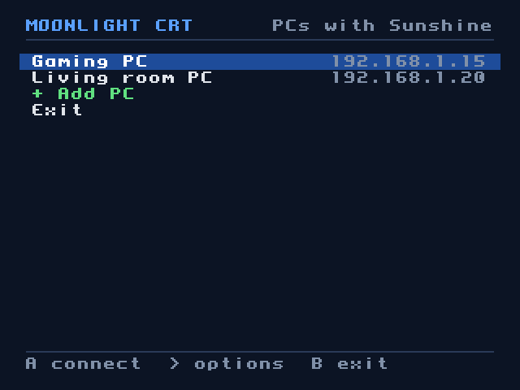
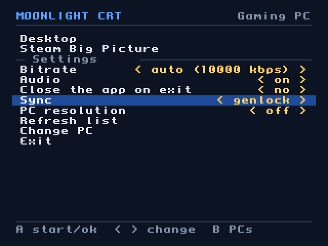

# MiSTer Moonlight CRT

A [Moonlight](https://moonlight-stream.org) client for [Sunshine](https://github.com/LizardByte/Sunshine)
that runs on the MiSTer FPGA's ARM and plays the stream through a modified version of the
amazing [H264 core](https://github.com/owenb321/MiSTer_h264_decoder), which decodes H.264 in the FPGA.
It is aimed at CRTs (15 kHz or 31 kHz). The modified core (in `core/`) adds 240p output, a 640-square-pixel picture
and a genlock: the raster follows the PC's own frame rate, to cut the latency and to keep the
stream smooth when the PC's frame rate is not a constant 60 Hz. The stock H264 core (480i at
59.94 Hz) works too, without these.

- On-screen menu: the list of PCs, Sunshine's apps, bitrate,
  audio, sync, the PC's resolution, pairing with an on-screen PIN. The stream is always 640x480.
- Sync with the PC, the core's video PLL following the PC's frame rate (see *Settings*).
- Pads, keyboard and mouse through the core,
  rumble on the MiSTer's pads, mouse mode on the pad.

> **Unofficial, experimental and AI-assisted.** This project was made with the help of AI: the
> code was written together with Claude. Use at your own risk.

| The list of PCs | The apps and the settings |
| --- | --- |
|  |  |

## Layout

| Folder | What |
| --- | --- |
| `client/` | the Moonlight client |
| `core/` | a build of the H264 core: 640-pixel picture, 240p output, genlock |

## Install

1. Copy the release zip's `Scripts` and `MiSTer_moonlight_crt` folders to the root of the SD card
   (`/media/fat`). The zip includes the H264 core, in `MiSTer_moonlight_crt/core`.
2. Run **Scripts → mister_moonlight_crt**: the list of PCs opens. Choose *+ Add PC* and type the IP
   address of the PC with Sunshine (on-screen keyboard with the pad, or a real keyboard), then a
   name. If `mister_moonlight_crt.conf` has `HOST=...`, that PC enters the list by itself.
3. The menu shows a PIN to enter in Sunshine's web page (PIN tab).

`MiSTer_moonlight_crt/mister_moonlight_crt.conf` is created from `mister_moonlight_crt.conf.example` on the
first run; `HOST` there is required only with `MENU=0`.

## Controls

| | |
| --- | --- |
| Menu | d-pad or arrows, A / Enter / Start confirm, B / Esc back (from the list of PCs: exit) |
| List of PCs | A connects, right opens the PC's options (rename, change address, remove); from the apps, B goes back to the list |
| On-screen keyboard | A types the chosen key, Start / Enter confirm, B / Esc cancel; a real keyboard types directly |
| Back to the menu | Select+Start+LB+RB, Ctrl+Alt+Shift+Q, or *Program menu* in the MiSTer OSD |
| Guide | Select+Start, or *Send Home to the program* in the MiSTer OSD |
| Mouse mode | hold Start alone for 1 s (a short rumble confirms): left stick or d-pad = pointer, right stick = wheel, A/B/X = left/right/middle button |

If the buttons or the key combinations don't work as expected (for example the combination to go
back to the menu), define the pad's buttons from the core's OSD, as with any other MiSTer core.

## Settings

In the menu: bitrate (up to 10 Mbps; auto = 10 Mbps with *genlock*, 5 Mbps with *genlock low latency*
and *60 Hz*), audio, closing the app on exit, sync, the
PC's resolution. The choices are kept in `MiSTer_moonlight_crt/menu.cfg`, with the list of PCs.

**Sync**:
- *genlock* (the default): the core moves its video PLL and the raster runs at the PC's rate
  (59.94 Hz too), and the core keeps one decoded picture in reserve (about 10 ms more latency
  than *genlock low latency*). It locks within 10-20 s of the start and after a 240p/480i switch.
  The reserve covers the large pictures of high bitrates (above ~20 KB a picture takes the core
  more than a frame to decode) and the irregular arrivals of a Wi-Fi link.
- *genlock low latency*: the same without the reserve. The video quality is lower than with
  *genlock* (auto bitrate 5 Mbps instead of 10), for slightly less latency (about 10 ms). Best at
  5 Mbps: at higher bitrates the large pictures arrive late and the previous picture is repeated.
- *60 Hz*: the core stays at 60 Hz and a picture that would land right at the pickup goes to the
  next one (up to one more frame). Only for a PC at exactly 60 Hz: at 59.94 Hz a picture is
  repeated about every 17 s.

With either genlock, during the first minute of play a few frames may be repeated or skipped while
the genlock locks on to the PC's rate: it takes longer when the PC is at 59.94 Hz and the stream
starts on the desktop (which sends pictures irregularly), and it is smooth from then on.

**PC resolution** (off, 640x480, 1024x768, 1280x960, 1280x720): during the stream Sunshine sets
the desktop to that resolution and restores its own at the end. With a 16:9 desktop the 640x480
stream arrives letterboxed (Sunshine adds the bars); with a 4:3 resolution the picture fills the
screen. The stream stays 640x480 (so 1280x720 is still letterboxed). It needs a recent Sunshine
with **Advanced Display Options > Resolution: "Use resolution provided by the client"**; the PC's
monitor (or a virtual display) must accept the resolution.

The log is `MiSTer_moonlight_crt/last_stream.log`, written to the SD when the program exits. With
`-stats` in `EXTRA` it also reports every 10 s the PC's frame rate and the repeated or dropped
frames, and `trace.csv` is written at the stream's end (for tests only).

## This repository's core

The core in `core/` (the `H264_core` artefact of the GitHub Actions) has a **640-pixel** wide
picture with equal lines: a 640x480 stream arrives 1:1, a 320x240 one exactly x2, without any
horizontal scaling. Without the genlock it runs at exactly 60.000 Hz; with it, at the PC's rate.

In the core's OSD: *Output Mode* 15kHz (480i) or 31kHz (480p); at 15kHz, *15kHz Mode* 240p
switches the stream to 240p (the menu stays at 480i; the 640x480 stream on alternate lines).
No 50 Hz.

## Build

On Linux (Ubuntu 24.04: `gcc-arm-linux-gnueabihf cmake ninja-build pkg-config`, plus
`qemu-user` and `ffmpeg` for the test):

    client/scripts/build.sh

It builds the static dependencies (OpenSSL, curl, expat, Opus), the program, runs the test
against a fake core in memory, and writes the SD-card zip.

## Credits and licences

- Program: GPL-3.0-or-later (`LICENSE`).
- `client/third_party/moonlight-common-c`, `client/third_party/libgamestream`:
  [moonlight-stream](https://github.com/moonlight-stream), GPL-3.0.
- `client/third_party/h264ring`: the H264 core's HPS library, MIT
  (owenb321/MiSTer_h264_decoder v1.1.0, `hps/`). The session, error and input handling follow
  that project's own Moonlight client (`clients/moonlight/src/mister`).
